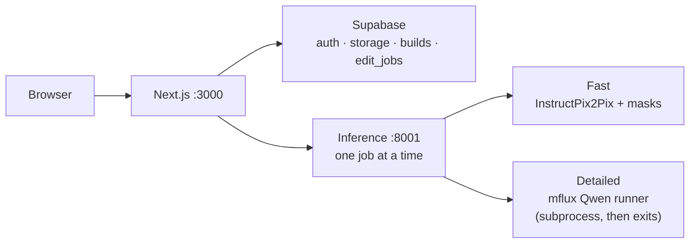
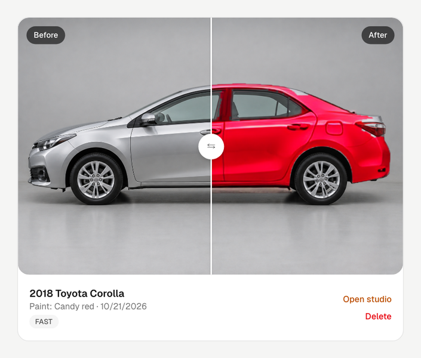
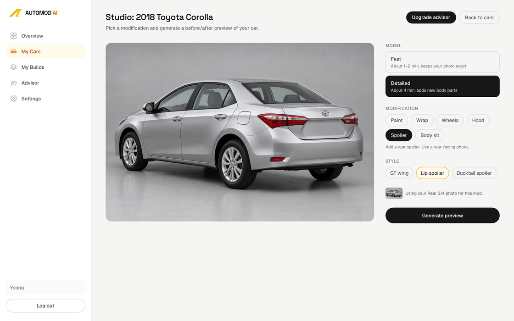
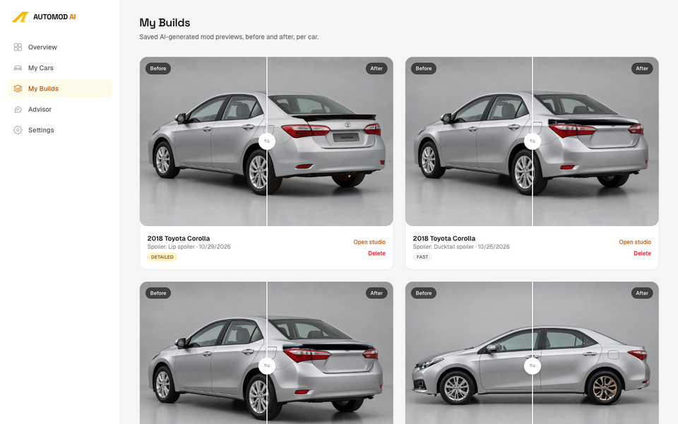
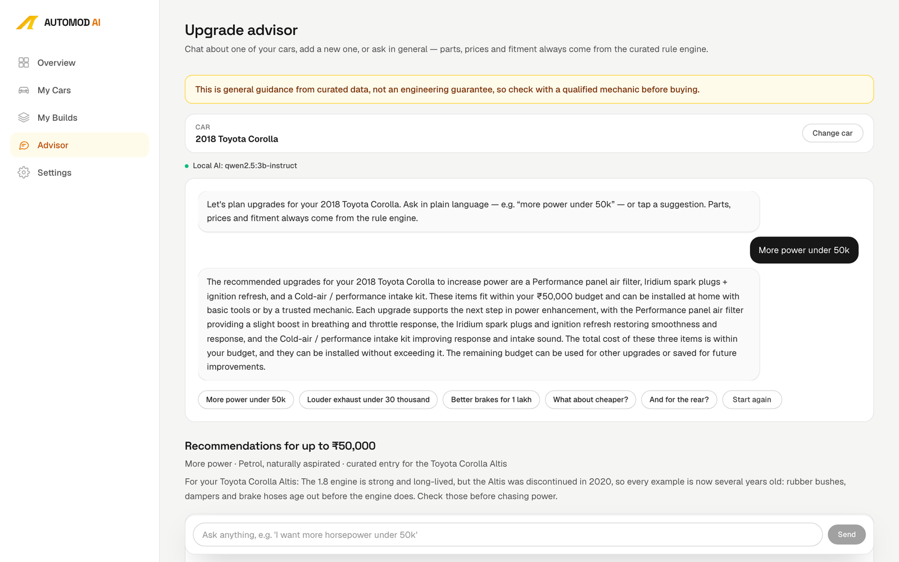

<p align="center">
  
</p>

# AutoMod AI

**AI car modification visualiser** — upload a photo of your car, preview mods before you spend.

[](https://nextjs.org/)
[](https://www.python.org/)
[](https://supabase.com/)
[](#team--acknowledgements)


## What it does

- **Photo-realistic mod previews** on *your* car photo — paint, wraps, wheels, hood, spoilers, and Detailed body-kit parts (lips, skirts, diffuser, bumper finishes)
- **Two engines in Studio** — Fast (masked InstructPix2Pix) and Detailed (Qwen Image Edit via mflux), with a one-job-at-a-time queue so they never fight for GPU/RAM
- **Build gallery** — every generate is saved under My Builds with a before/after compare slider; delete removes only that build’s exclusive files
- **Upgrade Advisor** — budget-aware parts and fitment from a curated rule engine, with optional local LLM phrasing (or offline Basic mode)

## Results


*Toyota Corolla · Detailed engine (Qwen-Image-Edit-2511 q4 + Lightning LoRA) · raw output (`postprocess: none` in `inference/qwen/prompts.json`). Left → right: side skirts, rear diffuser, lip spoiler.*

## Two engines

| | **Fast** | **Detailed** |
|---|---|---|
| Stack | InstructPix2Pix (+ project LoRA for hood/spoiler), YOLO11s-seg panel masks | Qwen-Image-Edit-2511 **q4** via **mflux** (MLX) + Lightning LoRA |
| Behaviour | Edits the frame, then composites **only masked panels** back — background, glass, lights, wheels stay pixel-identical unless targeted | Re-renders the **whole** image |
| Typical time | ~1–2 minutes | ~4–5 minutes on Apple Silicon |
| Memory | Low; shares one edit lock with Detailed | Peaks ~31 GB — **never** run alongside Fast or another Qwen job |

**When to use which:** prefer Fast for paint / wrap / wheels when you want the rest of the photo untouched. Prefer Detailed when you need new geometry (front lip, side skirts, rear diffuser, GT wing, bumper gloss) and can accept a full-frame re-render.

Locked Detailed prompts and seeds live in `inference/qwen/prompts.json`. Studio shows an **Experimental** tag on newly ported Detailed paint/wrap/wheels/hood options.

### Mods in Studio (from `lib/mods.ts`)

| Category | Examples | Engines |
|---|---|---|
| Paint / Wrap | Gloss black, candy red, matte black, satin colours | Fast + Detailed (many Experimental on Detailed) |
| Wheels / Hood | Bronze, gold, carbon fibre, matte black hood | Fast + Detailed |
| Spoiler | Lip spoiler, ducktail; GT wing on Detailed | Fast and/or Detailed per option |
| Body kit | Side skirts, front lip, rear diffuser, bumper gloss | **Detailed only** |

## How it works



The web app never keeps the Detailed model loaded. Each Detailed job is a short-lived `inference/qwen/runner.py` subprocess that loads, edits, writes a PNG, and exits so RAM is freed.

## Upgrade Advisor

The Advisor (sidebar → **Advisor**, or per-car) is deliberately boring about facts:

1. A **curated rule engine** (`lib/advisor/data.ts` + `recommend.ts`) is the only source of parts, price ranges, fitment notes and installer search links.
2. A **local 3B model** (`qwen2.5:3b-instruct` via Ollama) understands the question and phrases the reply — it does not invent shops or prices.
3. **Post-checks** discard explanations that mention unknown amounts, unknown part names, or invented stock engine/power figures.
4. If Ollama is down, slow, or a Detailed edit is queued/running, chat uses **Basic mode** (rule parser + templates) automatically so the 3B model does not compete with Qwen for memory.

## Screenshots

| Studio — Fast before/after | Studio — Detailed |
|:---:|:---:|
|  |  |
| **My Builds** | **Advisor** |
|  |  |

## Tech stack

| Layer | Choices |
|---|---|
| Frontend | Next.js 16, React 19, Tailwind CSS 4, GSAP / Lenis (landing scroll) |
| Backend / DB | Next.js Route Handlers, Supabase Auth + Postgres + Storage (`car-photos` bucket) |
| Inference | FastAPI on `127.0.0.1:8001`, shared engine lock, Detailed as subprocess |
| Models | InstructPix2Pix, YOLO11 panel weights (`weights/panel_best.pt`), Qwen-Image-Edit-2511 q4 (mflux), Ollama Qwen2.5 3B |
| Tooling | Vitest (`npm test`), `npm run start:all` / `bash scripts/stop.sh` |

## Quick start

**Prerequisites:** Node.js 20+, Python 3.11+ with `inference/.venv`, a Supabase project, optional Ollama + `qwen2.5:3b-instruct` for Advisor Local mode, Apple Silicon + [mflux](https://github.com/filipstrand/mflux) for Detailed.

```bash
cp .env.local.example .env.local
# Fill NEXT_PUBLIC_SUPABASE_URL and NEXT_PUBLIC_SUPABASE_ANON_KEY.
# Also set: INFERENCE_URL=http://127.0.0.1:8001
# Apply files under supabase/migrations/ to your project (SQL editor or CLI).

cd inference
python3.11 -m venv .venv
.venv/bin/pip install -r requirements.txt
cd ..

npm install
ollama pull qwen2.5:3b-instruct   # optional
npm run start:all                 # engine :8001 + Next.js :3000
```

Open [http://localhost:3000](http://localhost:3000). Ctrl+C stops both processes; if a port sticks: `bash scripts/stop.sh`.

```bash
npm test    # Vitest — advisor, mods, builds paths, …
```

## Demo car

The primary demo vehicle in-app and in these screenshots is a **2018 Toyota Corolla** (silver studio photos). Secondary catalogue cars for the Advisor include Hyundai Creta / Verna and Honda City where curated.

## Limitations

- Detailed is **slow** and needs on the order of **~31 GB** of memory; only one edit runs at a time across Fast and Detailed.
- Detailed may invent text on blank number plates and **re-renders the whole frame** (not a masked composite).
- Low-resolution or heavily compressed phone photos give weak or soft results.
- Advisor prices are curated India ranges (last reviewed in-repo), **not** live marketplace prices.
- Advisor guidance is **not** an engineering guarantee — confirm fitment with a qualified mechanic before buying.

## Team & acknowledgements

**Team:** Yooraj Gole, Yash Sawant, Yuvraj Gandhi, Nisarg Mulik — Vidyalankar Institute of Technology, Sem 7 Deep Learning mini project.

**Built with:** [InstructPix2Pix](https://github.com/timothybrooks/instruct-pix2pix), [Ultralytics YOLO11](https://github.com/ultralytics/ultralytics), [Qwen-Image-Edit](https://github.com/QwenLM/Qwen-Image) / mflux-community q4 weights, [mflux](https://github.com/filipstrand/mflux), Lightning LoRA (LightX2V), [Ollama](https://ollama.com/) / Qwen2.5, [Supabase](https://supabase.com/). Model and library licences — **see upstream**.

**Licence:** This repository has **no `LICENSE` file** yet. Do not assume a public open-source grant until one is added. Upstream model cards and library licences still apply to the weights and tools listed above — **see upstream**.

## Repo layout (high level)

| Path | Role |
|---|---|
| `app/` | Next.js App Router — landing, auth, dashboard, API routes |
| `components/` | UI — Studio, Advisor, builds, landing sections |
| `lib/advisor/` | Rule engine, intent, Ollama hooks, post-checks |
| `lib/mods.ts` | Fast/Detailed option catalogue for Studio |
| `inference/` | FastAPI server, InstructPix2Pix path, `qwen/` Detailed runner |
| `supabase/migrations/` | Schema + RLS for cars, builds, photos, edit_jobs |
| `docs/screenshots/` | Images used by this README |

## Further reading

- Project brief: [`CLAUDE-2.md`](./CLAUDE-2.md)
- Inference engines & endpoints: [`inference/README.md`](./inference/README.md)
- Screenshot inventory: [`docs/screenshots/README.md`](./docs/screenshots/README.md)

